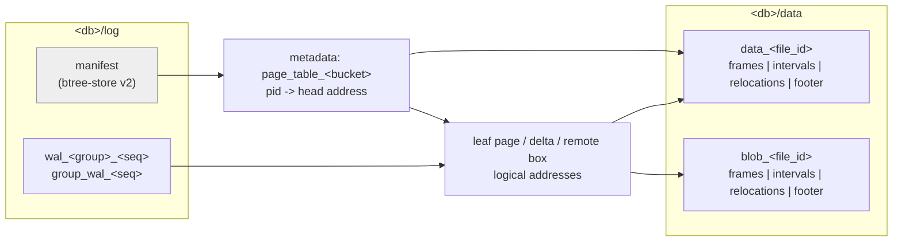
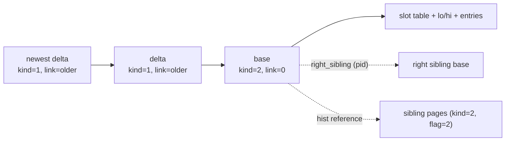
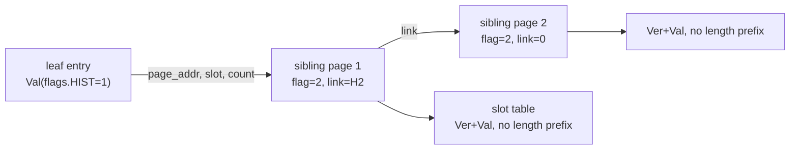

# Mace Persistent Format v1

This document is the byte-level specification of what Mace writes to disk. It exists so that a reader
can be implemented without reading engine code, and so that any change to a persisted byte has to walk
the version rules in [Version rules](#version-rules) instead of riding along with a refactor.

It describes bytes and the checks a reader performs. Runtime semantics stay in
[design.md](./design.md); offline inspection stays in [cli.md](./cli.md).

Persisted surfaces:

| Surface | Version location | v1 value | Evolution |
| --- | --- | --- | --- |
| data/blob files | per-file footer `version` (u16) | 1 | add a value; files of different versions coexist in one database, each file is decoded by its own footer |
| metadata store | `version/current_version` (u64) | 1 | raise the version and ship an offline migration; an unsupported value is `BadVersion` |
| manifest file | `btree-store` format (external) | 2 | `btree-store migrate`; see [migration.md](./migration.md) |
| WAL | none: no file header, no version field, no layout tag | — | no cross-version compatibility; drain before upgrading |

The rest of this document defines each surface in that order.



## Conventions

### Byte order and scalar width

- Every persisted scalar is little-endian. The engine is compiled only for 64-bit little-endian
  targets (`static_assert!(cfg!(target_endian = "little"))` and
  `static_assert!(size_of::<usize>() == size_of::<u64>())`).
- `usize` is eight bytes on every supported target. Reader implementations must treat it as `u64`.
- `bool` occupies one byte and is written as `0` or `1`.

### Identifiers

| Name | Type | Meaning |
| --- | --- | --- |
| `pid` | `u64` | logical page id inside one bucket; `0` (`NULL_PID`) means "no page" |
| logical address (`addr`) | `u64` | monotonically increasing id of one persisted record; `0` (`NULL_ADDR`) means "none" |
| file offset | `u64` | byte position inside one data/blob file or one WAL file |
| `file_id` | `u64` | one data file and one blob file may share a `file_id`; they are separate namespaces |
| `seq` | `u32` | index of a frame inside a file's relocation table |
| `stream` | `u8` | WAL stream: `0..=127` is a per-group stream, `255` is the shared stream |
| `txid`, `cmd` | `u64`, `u32` | version pair; `Ver` below |
| `bucket_id` | `u64` | bucket identity, allocated monotonically |

`Position` is the durable location pair used by WAL positions, checkpoint floors and page LSNs:

```text
offset  size  field
0       8     file_id (u64, little-endian)
8       8     offset  (u64, little-endian)
```

`Position { file_id: 0, offset: 0 }` is `Position::MIN`; `{ u64::MAX, u64::MAX }` is `Position::MAX`
and means "no position".

### Varint32

Keys are length-prefixed with an unsigned LEB128-style varint that is at most five bytes. Seven bits
per byte, low group first, the high bit means "another byte follows". Values `0..=127` take one byte.

### CRC-32C

Every checksum in this document is CRC-32C (Castagnoli), stored as a little-endian `u32`. The covered
range is stated per structure; it never includes the checksum field itself.

### Empty values and null records

- A tombstone record is a `Record` whose payload is empty. The key still exists in the leaf.
- `NULL_ADDR` (0) in a `Val` remote field, a box `link`, or a `page_table` value means "none".
- There is deliberately no magic number anywhere in data/blob files or WAL files. A data/blob file is
  self-describing only through the fixed footer at its end; the WAL has no framing tag at all. This is
  what makes a wrong layout dangerous, and it is why this document, the compile-time pins and the
  golden fixtures exist.

## Directory layout

```text
<db>/
  data/
    data_<file_id>          data file (Bw-Tree boxes)
    blob_<file_id>          blob file (remote boxes)
  log/
    manifest                btree-store metadata manifest (external format, v2)
    wal_<group>_<seq>       per-group WAL stream, group 0..=127
    group_wal_<seq>         shared durable WAL stream
```

- The data root and log root default to `<db>/data` and `<db>/log`.
- `file_id` comes from the metadata sequence counter (`misc/sequences.next_file_id`). Consecutive
  values are not guaranteed for a single bucket: every data and blob file in the database draws from
  the same counter.
- `seq` is the WAL file sequence. It is not the group id and it is not reused.
- A bucket's files are identified through metadata records (`data_stat` / `blob_stat`), not by
  filename ranges.

## data/blob files

### File layout

```text
+------------------+-----------+----------------+---------+
| data frames      | intervals | relocations    | footer  |
+------------------+-----------+----------------+---------+
  file offset 0      ...         ...              end-24
```

Frames are written first, in ascending logical address order. Then one interval table, one relocation
table and the fixed footer. File length is exactly `frames_len + 16*nr_intervals + 32*nr_reloc + 24`.

### Frame

A raw frame is a persisted box:

```text
+----------------+-------------------+------------------+
| box header     | payload header    | payload body     |
| 60 bytes       | 40 / 8 / 8 bytes  | payload_size -   |
|                |                   | payload_hdr_len  |
+----------------+-------------------+------------------+
```

- Box header: see [Record header](#record-header).
- Payload header: `DiskBaseHeader` (40) for base boxes, `DiskDeltaHeader` (8) for deltas,
  `DiskRemoteHeader` (8) for remote boxes.
- `last frame end == interval table start`.

A raw frame's stored length is `60 + payload_size`. The box header's `total_size` is
`64 + payload_size`: it counts the four runtime reference-count bytes that are **not** written. A
reader that equates `total_size` with the stored frame length will reject every valid file.

### Interval table

`Interval` is 16 bytes:

```text
offset  size  field
0       8     lo  (u64, lowest logical address in this file)
8       8     hi  (u64, highest logical address in this file)
```

A checkpoint writes exactly one interval per file. A GC rewrite may write more than one when it
produces a file from several disjoint source ranges. Intervals of one bucket must not overlap:
for any two intervals `a`, `b`, `a.hi < b.lo` or `b.hi < a.lo`.

### Relocation table

`Reloc` is 24 bytes and `AddrPair` is 32 bytes:

```text
AddrPair
offset  size  field
0       8     key          logical address (u64)

Reloc at AddrPair offset 8
offset  size  field
0       8     off          stored frame offset in this file (usize = u64)
8       4     raw_len      length of the decoded frame (u32), >= 60
12      4     compressed_len  stored length when compressed, 0 when raw (u32)
16      4     seq          index of this frame in the table (u32)
20      4     crc          CRC-32C of the stored frame bytes (u32)
```

- Entries are sorted strictly ascending by `key`. Readers locate a record by binary search on `key`.
- `seq` is the table index and is used as the bit index of the file's inactive bitmap. It must be
  unique and less than the stat record's `total_elems`.
- `off` is independent of `seq`: a rewrite may store frames in a different order than the table.
- `raw_len` is always the decoded frame length. A raw frame stores exactly `raw_len` bytes at `off`; a
  compressed frame stores `compressed_len` bytes at `off`.
- For a raw frame, `crc` covers the `raw_len` stored bytes. For a compressed frame, `crc` covers the
  `compressed_len` stored bytes, that is the compressed stream itself, never the decompressed frame.

### Footer

`FileFooter` is 24 bytes:

```text
offset  size  field
0       2     version          (u16)
2       6     padding          (6 zero bytes in v1)
8       4     nr_reloc         (u32)
12      4     nr_intervals     (u32)
16      4     reloc_crc        CRC-32C of the whole relocation table
20      4     interval_crc     CRC-32C of the whole interval table
```

The relocation table starts at `file_len - 24 - 32*nr_reloc`; the interval table starts at
`file_len - 24 - 32*nr_reloc - 16*nr_intervals`. Those two regions are adjacent and in that order.

The six padding bytes are the only reserved bytes a v1 reader rejects: `version == 1` with any non-zero
padding byte is `BadVersion`. They are not an extension point.

### Compressed frames

Compression is enabled per bucket (`PersistedBucketOptions.enable_compression`). When a frame is at
least the compression minimum and the encoded result is smaller than the raw frame by the gain margin,
the writer stores a zstd frame in place of the whole raw frame:

```text
raw:        [ box header 60 | payload header | payload body ]      stored_len = raw_len
compressed: [ zstd frame over the raw bytes above ]                stored_len = compressed_len
```

The relocation entry is the only place that distinguishes them: `compressed_len == 0` means raw.
The frame's inner box header is unchanged, so `raw_len` and the inner `total_size` still describe the
decoded frame.

### Reader location algorithm

1. Read the last 24 bytes. Reject a file shorter than 24 bytes.
2. Decode `version`; reject unknown values with `BadVersion`. For v1 reject non-zero padding with
   `BadVersion`.
3. Compute `32*nr_reloc`, `16*nr_intervals` and their sum with overflow checks. Reject a file shorter
   than the tables plus the footer.
4. Read and CRC-check the relocation table; reject on mismatch.
5. Read and CRC-check the interval table; reject on mismatch.
6. To read a logical address, binary-search the relocation table by `key`. A missing key is
   `NotFound`.
7. Read `stored_len` bytes at `off`, CRC-check them, decompress when `compressed_len != 0`, then
   decode the box header and payload header with the checks in
   [Record header](#record-header).

### Per-file version dispatch

The version lives in each file's own footer, and metadata stores a `version` per file in the stat
record. Files of different versions may coexist in one database and inside one bucket: a reader must
select the decoder from that file's footer, and GC may reuse a `file_id` only when the source and
target versions are equal.

Consequences that are part of the format contract:

- Adding a `data/blob` version does not require a whole-database offline migration. Old files stay
  readable through their old decoder until GC rewrites them at the current version.
- A reader release must keep every decoder for a version still present in databases that may be
  opened by it. Dropping a decoder is allowed only when no file of that version can remain.
- A vN writer must emit only vN files (`version = N`, layout per that version) and must not rewrite an
  older file at the new layout without a migration rule.

### How one write reaches these bytes

For `put(key, value)` with a value at or above the bucket's `inline_size`:

1. WAL: one `Update` record with the key and the new value
   ([WAL](#wal)).
2. Memory page chain: a new leaf delta whose key is `Ver || key`, whose `Val` has `REMOTE_BIT` and the
   new blob's logical address, and whose `link` points at the previous head.
3. Checkpoint cut: every box on the live chain is handed to the file builder. Base and delta frames go
   to `data_<file_id>`; remote frames go to `blob_<file_id>`. Each stored frame gets one `AddrPair`.
4. Metadata transaction: `page_table_<bucket>/<pid> = head address`, interval rows, stat records and
   the bucket durable frontier commit together.
5. Reader: `pid -> head -> link ... -> base` finds the entry; a `REMOTE_BIT` value resolves through the
   blob file's relocation table.

The three identities are separate on purpose: `pid` is the logical page, the logical address names a
persisted record, and the file offset names a physical position. GC rewrites only the last one.

## Bw-Tree nodes

### Page chain

A page is a chain of boxes sharing one `pid`:



- The page table maps `pid` to the head box. `NULL_ADDR` means the page is unmapped.
- `link` points from a delta to the previous box of the same page; a base ends the chain.
- `right_sibling` is a `pid`, not an address. `0` means "rightmost".
- Sibling pages (history) are reached by logical address, not through the page table
  ([Sibling and history pages](#sibling-and-history-pages)).

### Record header

`DiskBoxHeader` is 60 bytes, `#[repr(C, packed(1))]`:

```text
offset  size  field
0       1     kind               1 = delta, 2 = base, 3 = remote
1       1     node_type          1 = leaf, 2 = internal
2       1     flag               1 = normal, 2 = sibling (base only)
3       1     group              owning write group (0..=127)
4       4     total_size         64 + payload_size
8       4     payload_size       bytes after this header
12      8     pid                logical page id, 0 when none
20      8     txid               version of the box
28      8     addr               this box's logical address
36      8     link               previous box of the chain, 0 at a base
44      16    lsn                Position
```

`total_size` and `payload_size` obey `total_size == 64 + payload_size`. Neither the stored length alone
nor the in-memory 64-byte header should be substituted for the other: the stored frame is
`60 + payload_size` bytes.

The in-memory header is 64 bytes; the missing four bytes are the runtime reference count, which is never
written.

`flag = 2` is legal only with `kind = 2` (a history page). A remote box always has `node_type = 1` and
`flag = 1`; a delta always has `flag = 1`.

### Base payload

`DiskBaseHeader` is 40 bytes, immediately after the box header:

```text
offset  size  field
0       2     elems                  number of entries / slot-table entries
2       2     split_elems            legacy merge hint, 0 in v1 writes
4       4     size                   payload length, header included
8       8     right_sibling          pid of the right sibling, 0 if none
16      8     merging_child          pid of a child being merged, 0 if none
24      4     lo_len                 length of the low boundary key
28      4     hi_len                 length of the high boundary key, 0 if none
32      4     prefix_len             bytes stripped from entry keys
36      1     merging                0 or 1
37      1     is_index               0 or 1 (1 = internal)
38      1     has_multiple_versions  0 or 1
39      1     padding                writer guarantee: 0
```

`size` covers the whole base payload including this 40-byte header. A base payload is:

```text
+----------------+---------------------+--------+--------+------------------+
| base header 40 | slot table elems*4  | lo     | hi     | entries          |
+----------------+---------------------+--------+--------+------------------+
```

- Slot entries are `u32` byte offsets **from the first byte of the base header** (in a file frame:
  `frame_start + 60 + slot`). They are not relative to the slot table.
- `lo` and `hi` are stored complete (`lo_len`, `hi_len` bytes) directly after the slot table. A missing
  `hi` has `hi_len = 0`.
- Entry keys are stored without the first `prefix_len` bytes; a reader prepends the stored boundary.
- Entries appear in slot order and their sort order is the one described below.
- `padding` at offset 39 is a writer guarantee of zero. v1 readers do not reject a non-zero value here,
  so it is not an extension point.
- For a persisted leaf base, the writer sets `payload_size == size`: the in-memory hint tail
  ([Leaf hint tail](#leaf-hint-tail)) is not written. A reader must use `size`, not `payload_size`, to
  bound the slot table and entries.

### Leaf entries

A leaf entry is a key followed by a `Val`:

```text
key:  Varint32(len) | Ver (12 bytes) | raw key without prefix
Ver:  txid (u64) | cmd (u32)
```

The key is `Ver || raw` inside the length prefix; `len` counts the 12 `Ver` bytes plus the raw key.
The declared length lets a reader skip from one entry to the next; entries have no alignment padding.

`Val` envelope:

```text
offset  size  field
0       1     flags
1       1     group_id
2       4     data_len
6       14    hist reference, present only when flags bit 7 is set
...     -     inline record or remote address
```

Flags:

| Bit | Value | Meaning |
| --- | --- | --- |
| 0 | `0x01` | tombstone |
| 1 | `0x02` | merge operand |
| 4 | `0x10` | remote: the value body is an 8-byte logical address, not inline bytes |
| 7 | `0x80` | history reference present |

Bits 0 and 1 are mutually exclusive in a valid record.

The optional history reference is:

```text
offset (relative to Val start)  size  field
6                               8     page_addr  logical address of the first history page
14                              2     slot       first slot inside that page
16                              4     count      number of older versions in the region
```

The value body follows at offset `6 + (has_hist ? 14 : 0)`:

- inline: `data_len` bytes of `Record`;
- remote: one `u64` logical address; `data_len` still holds the record's length. The bytes of the record
  live in a remote box in a blob file.

`Record` is:

```text
offset  size  field
0       1     group_id (never carries the runtime merge tag)
1       ..    payload bytes; empty payload means tombstone
```

A reader resolves a value by taking `data_len` bytes from the inline region, or by reading `data_len`
bytes of the resolved remote box.

### Internal entries

An internal entry is a key and an 8-byte index:

```text
key:   Varint32(len) | raw key without prefix      (no Ver)
index: pid (u64)
```

`Index` is the child `pid`; `0` (`NULL_PID`) is a null index. The first entry's key is the page's `lo`
boundary and the search rule is "greatest key less than or equal to the target".

### Deltas

```text
DiskDeltaHeader (8 bytes)
offset  size  field
0       4     klen      encoded key length
4       4     vlen      encoded value length

then: klen bytes of key | vlen bytes of value
```

- Leaf delta: key is the leaf key encoding (`Varint32 | Ver | raw`, prefix already stripped), value is a
  complete `Val` envelope.
- Internal delta: key is the internal key encoding (`Varint32 | raw`, no `Ver`), value is an 8-byte
  `Index`.
- A delta has `payload_size == 8 + klen + vlen` and `link` pointing at the previous box.
- A new box's LSN is raised to the group's durable checkpoint LSN before it is written.

### Remote boxes (blob records)

```text
DiskRemoteHeader (8 bytes)
offset  size  field
0       8     size      length of the record payload

then: size bytes of Record
```

`payload_size == 8 + size`, `node_type = 1`, `flag = 1`, `pid = 0`. The delta (or base) value that
refers to it stores the remote box's logical address in the `REMOTE_BIT` envelope.

### Sibling and history pages

Older versions of one key live in a chain of sibling base pages, referenced by the `Val` history
reference. They are base boxes with `flag = 2` and `pid = 0`, allocated outside the page table.



- `lo_len = hi_len = 0`, `prefix_len = 0`, `elems` is the number of entries stored in that page.
- The slot table is normal; each entry is `Ver (12 bytes) | Val`, with no length prefix and no raw key.
  The key is the owning leaf entry's key.
- `count` counts versions across the whole chain. `slot` is only valid inside the page named by
  `page_addr`; following `link` continues at slot 0 of the next page.
- The first `count` entries starting at `slot` are the older versions of that key, newest first.

### Leaf hint tail

A leaf base is allocated with an extra tail in memory: a `u32` sibling-page count, that many `u64`
addresses, a `u32` remote-box count, and that many `u64` addresses. It is a checkpoint accelerator and
is **never persisted**: the writer truncates `payload_size` to `size` when it serializes a leaf. A
persisted leaf therefore has `payload_size == size`.

### Page chain search

1. Start from the `page_table` address for `pid`. `0` means the key is not mapped.
2. Read the head. While it is a delta, collect its key/value and follow `link`.
3. The first base ends the chain. Deltas newer than the base override it; a delta tombstone hides an
   older value.
4. If the newest visible value carries `REMOTE_BIT`, read the remote box by its logical address.
5. If the key has a history reference, continue the search in the sibling chain for the requested
   snapshot.

## Metadata

The metadata store is a `btree-store` manifest with named buckets. This section defines the keys and
value bytes Mace writes into it. `btree-store` owns the manifest's own page format; this document owns
only the bytes of keys and values.

### Buckets and key encodings

| Bucket | Key | Value |
| --- | --- | --- |
| `version` | literal `current_version` | 8-byte LE u64 |
| `misc` | literal `options` | `PersistedOptions` canonical JSON |
| `misc` | literal `sequences` | `Sequences` (24 bytes) |
| `misc` | ASCII `odf_<file_id>` | empty: orphan data-file marker |
| `misc` | ASCII `obf_<file_id>` | empty: orphan blob-file marker |
| `misc` | ASCII `wrc_<group_id>` | `WalRecycleState` (24 bytes) |
| `bucket_metas` | bucket name as UTF-8 bytes | `BucketMeta` (56 bytes) |
| `bucket_frontier` | LE u64 `bucket_id` | `BucketDurableFrontier` (2056 bytes) |
| `page_table_<bucket_id>` | LE u64 `pid` | LE u64 head address |
| `data_stat`, `blob_stat` | LE u64 `file_id` | `StatHdr` + `StatInner` + inactive bitmap |
| `data_interval_<bucket_id>`, `blob_interval_<bucket_id>` | LE u64 `lo_addr` | `IntervalPair` (32 bytes) |
| `obsolete_data`, `obsolete_blob` | LE u64 `file_id` | empty marker |
| `pending_del` | LE u64 `bucket_id` | empty marker |

`<bucket_id>` and `<group_id>` in bucket and key names are decimal ASCII. Bucket names are the user's
UTF-8 name; they are not escaped.

`MetaKind` in the engine source is an in-memory dispatch enum. It is not written to disk and has no
persisted key prefix.

### Value layouts

`Sequences` (24 bytes):

```text
offset  size  field
0       8     next_file_id
8       8     next_bucket_id
16      8     oracle
```

`PersistedBucketOptions` (48 bytes, `#[repr(C)]` on a 64-bit target):

```text
offset  size  field
0       8     cache_capacity       (usize)
8       8     cache_evict_pct      (usize, 10..=80)
16      8     pool_capacity        (usize)
24      8     checkpoint_size      (usize)
32      8     inline_size          (usize)
40      2     split_elems          (u16)
42      2     consolidate_threshold (u16)
44      1     enable_compression   (bool)
45      1     enable_backpressure  (bool)
46      2     _padding             writer guarantee: zero
```

`BucketMeta` (56 bytes, `#[repr(C)]`):

```text
offset  size  field
0       8     id
8       48    options   (PersistedBucketOptions)
```

`BucketDurableFrontier` (2056 bytes, `#[repr(C)]`):

```text
offset  size  field
0       8     bucket_id
8       16*n  lsn[0..n]   Position per logical write group, n = 128
```

`n` is 128 (`MAX_CONCURRENT_WRITE`). Every position is present; unused groups hold `Position::MIN`.

`StatHdr` (8 bytes) and the stat value:

```text
value = StatHdr | StatInner | inactive_seq[elems]

StatHdr
offset  size  field
0       4     elems   number of inactive sequences that follow
4       4     size    byte length of StatInner + inactive_seq[]

StatInner (56 bytes, `#[repr(C)]`), offsets relative to the start of StatInner
offset  size  field
0       8     file_id
8       8     up1
16      8     up2
24      4     active_elems
28      4     total_elems
32      8     active_size   (usize)
40      8     total_size    (usize)
48      8     bucket_id

inactive_seq: elems * u32, each the `seq` of an inactive frame
```

`IntervalPair` (32 bytes, `#[repr(C)]`):

```text
offset  size  field
0       8     lo_addr
8       8     hi_addr
16      8     file_id
24      8     bucket_id
```

`WalRecycleState` (24 bytes, `#[repr(C)]`):

```text
offset  size  field
0       1     group_id
1       1     stage        0 = none, 1 = intent, 2 = done
2       6     _pad         writer guarantee: zero
8       8     from_file_id
16      8     to_file_id
```

The following codecs exist in the engine source but v1 never writes them as metadata values:
`PageTableHdr`-prefixed page tables, `DeleteHdr`-prefixed delete lists and
`DelIntervalStartHdr`-prefixed interval lists, together with the `MapEntry` block encoding. v1 writes
`page_table` entries one per key, writes empty values for obsolete markers and deletes interval keys.
If a future version starts writing them, both this document and the fixtures must change in the same
commit.

### Persisted options JSON

`misc/options` holds UTF-8 JSON produced from struct field declaration order:

```json
{"concurrent_write":16,"sync_on_write":true,"gc_timeout":60000,"checkpoint_nudge_ms":60000,"data_garbage_ratio":20,"gc_eager":true,"blob_file_size":268435456,"blob_garbage_ratio":50,"lru_capacity":268435456,"stat_mask_cache_count":16384,"data_handle_cache_capacity":128,"blob_handle_cache_capacity":128,"data_file_size":67108864,"wal_buffer_size":16777216,"max_ckpt_per_txn":1000000,"wal_file_size":67108864,"truncate_corrupted_wal":true}
```

| Field | JSON type | Missing-field default |
| --- | --- | --- |
| `concurrent_write` | integer 1..=128 | 16 |
| `sync_on_write` | boolean | `true` |
| `gc_timeout` | integer (ms) | 60000 |
| `checkpoint_nudge_ms` | integer (ms) | 60000 |
| `data_garbage_ratio` | integer | 20 |
| `gc_eager` | boolean | `true` |
| `blob_file_size` | integer | 268435456 |
| `blob_garbage_ratio` | integer | 50 |
| `lru_capacity` | integer | 268435456 |
| `stat_mask_cache_count` | integer | 16384 |
| `data_handle_cache_capacity` | integer | 128 |
| `blob_handle_cache_capacity` | integer | 128 |
| `data_file_size` | integer | 67108864 |
| `wal_buffer_size` | integer | 16777216 |
| `max_ckpt_per_txn` | integer | 1000000 |
| `wal_file_size` | integer | 67108864 |
| `truncate_corrupted_wal` | boolean | `true` |

Rules:

- A missing field takes its default; an unknown field is ignored by the reader.
- The writer emits every field in the order above; this exact text is the canonical v1 encoding.
- The field set, the field names and the JSON types are part of `current_version`. Adding, removing or
  retyping a field changes persisted bytes and therefore requires a version raise plus a migration.
  Relying on reader tolerance for unknown fields would make two versions read one byte region
  differently.

### One commit unit

One metadata publish is a single `exec_multi` call covering every bucket touched by one flush round:
page table entries, interval rows, stat records, the bucket durable frontier and the sequences. A
crash leaves either none or all of that round's metadata. There is no partial publish to repair.

### Version gate

Startup reads `version/current_version` before any state:

1. If the key exists, the version is the little-endian u64 in its first eight bytes (exactly eight
   bytes is a writer guarantee).
2. The value must be `1`; anything else is `BadVersion`.
3. If the key is absent, the store must be pristine (no buckets, no state). A pristine store is
   bootstrapped with `current_version = 1` and `misc/options`.
4. `misc/options` must exist whenever the version record exists; a missing options record on a
   non-pristine store is `Corruption`. Bad JSON is `Corruption`.
5. A `misc/sequences` record without a version record is `BadVersion`; an absent one means the
   defaults (`next_file_id = 0`, `next_bucket_id = 0`, `oracle = 1`). `oracle` is the next txid, so
   starting at 1 keeps txid 0 unallocated.

## WAL

The WAL has no file header, no version field and no layout tag. It belongs to the binary that wrote it.

### Files

```text
log/wal_<group>_<seq>      stream group 0..=127
log/group_wal_<seq>        shared stream (stream id 255)
```

- `<group>` and `<seq>` are decimal ASCII.
- A stream appends records and starts a new file with `seq + 1` after the append that makes the file
  reach `wal_file_size` (default 64 MiB). Rotation is decided **after** the record is appended, so one
  file may exceed the limit by at most one record.
- Records are concatenated with no length prefix outside the record itself. Framing comes from the
  first byte.

### Entry types and payload types

```text
EntryType   0 = Update, 1 = Begin, 2 = Commit, 3 = Abort, 4 = Checkpoint
PayloadType 0 = Insert, 1 = Update, 2 = Delete, 3 = Merge
```

### Update record

`WalUpdate` is 51 bytes, `#[repr(C, packed(1))]`:

```text
offset  size  field
0       1     wal_type       0
1       1     sub_type       PayloadType
2       8     bucket_id
10      1     group_id       logical write group
11      4     size           payload length
15      4     cmd_id
19      4     klen           key length
23      8     txid
31      8     prev_id        previous LSN: file_id
39      8     prev_off       previous LSN: offset
47      4     checksum       CRC-32C
```

Payload, `size` bytes, immediately after the header:

```text
Insert / Update:  key (klen bytes) | value_len (u32) | value bytes
Merge:            key (klen bytes) | operand_len (u32) | operand bytes
Delete:           key (klen bytes), size == klen and no body
```

- Record length is `51 + size`; there is no other length prefix.
- `checksum` covers bytes `0..47` of the header followed by the `size` payload bytes.
- `Insert`/`Update`: `size == klen + 4 + value_len`.
- `Merge`: `size == klen + 4 + operand_len`; `operand_len` must be non-zero, because an empty operand
  cannot be encoded as a page record.
- `Delete`: `klen == size` and the record carries no value body.
- `prev_id`/`prev_off` are the previous LSN of the same key (`Position::MIN` when there is none).

### Begin, Commit, Abort

`WalBegin`, `WalCommit` and `WalAbort` are each 13 bytes:

```text
offset  size  field
0       1     wal_type     1 / 2 / 3
1       8     txid
9       4     checksum     CRC-32C over bytes 0..9
```

### Checkpoint

`WalCheckpoint` is 21 bytes:

```text
offset  size  field
0       1     wal_type     4
1       16    checkpoint   Position (file_id, offset)
17      4     checksum     CRC-32C over bytes 0..17
```

`checkpoint` records the last checkpoint floor the writer published. `Position::MAX` means "no floor
yet"; a reader must ignore such a record when choosing a scan start.

### Scanning and truncation

Recovery starts at the latest usable checkpoint floor:

1. Scan stream files from the highest `seq` downwards. In each file, walk records from offset 0.
2. For each record, read the type byte, then the fixed header. A short header, an unknown type byte, a
   checksum mismatch, an invalid payload type or a length that would pass the end of the file ends the
   walk of that file at that record.
3. In each file, the last checkpoint record with a position other than `Position::MAX` that appears
   before that file's first malformed record is that file's candidate. Walking files from newest to
   oldest, the first file that has a candidate supplies the scan start; if none has one, the scan
   starts at the oldest present file offset 0.
4. Redo then walks from that start forwards across files, applying committed transactions. A record is
   consumed only after the framing, the payload type, the key/value size bounds and the checksum all
   pass.
5. If a file has bytes after the last well-formed record, recovery either truncates the file at that
   record boundary (`truncate_corrupted_wal = true`, the default) or returns `Corruption`
   (`truncate_corrupted_wal = false`). A truncated file ends the scan; later files of that stream are
   not trusted.
6. A gap in a stream's `seq` sequence after recycling is `Corruption`.

`Update` validation bounds: `size <= MAX_KV_SIZE + 4`, `klen <= 64 KiB`, and for the three value-bearing
payload types `klen + value_len <= MAX_KV_SIZE`.

### No cross-version compatibility, and the drain rule

The WAL layout may change in any release, because it carries no version and promises nothing. In
exchange, the upgrade rule is mandatory:

1. Before replacing the binary, open the database with the current binary and close it normally.
   Normal shutdown drains abort cleanup, performs a final checkpoint of every dirty bucket and syncs
   the WAL, but it runs no WAL recycle round: GC is already stopped when that checkpoint publishes.
2. Open and close it normally a second time. This run starts from the durable checkpoint, so no
   record left in the WAL is still the only copy of a committed write, and its recycle rounds retire
   the covered segments as they run.
3. Then delete the remaining WAL files (`wal_*` and `group_wal_*`) or confirm they were recycled, and
   only then run the new binary.
4. A crash followed directly by an upgrade is not supported. A WAL written by a different layout has
   no recognizable marker, so the new binary treats it as a malformed tail: with the default option it
   truncates at the first bad record and some uncheckpointed committed writes are lost; with the option
   disabled the database does not open.

This is a format consequence, not a defect to be papered over: the WAL is part of the binary that wrote
it, exactly like the checkpoint metadata it depends on.

## Version rules

### Axes

- **data/blob: per file.** The footer `version` selects the decoder. A new version may be introduced
  without an offline migration: new files use the new version and existing files keep their own
  decoder. GC emits the current version and may reuse a `file_id` only when source and target versions
  are equal. An old decoder may be removed only after no file of that version can still exist.
- **metadata: whole database.** `version/current_version` must match; otherwise `BadVersion` and an
  offline migration is required. The `misc/options` JSON field set belongs to this axis.
- **manifest: external.** `btree-store` owns it (currently version 2) and its migration procedure.
- **WAL: none.** Layout may change freely under the drain rule; there is no version field to raise.

### What forces which axis

| Change | Axis | Action |
| --- | --- | --- |
| any data/blob byte layout, table shape, footer field or `Record`/`Val` encoding | data/blob `version` | add a version, keep the old decoder, update fixtures and this document together |
| any metadata key encoding or value layout, or the options JSON field set | `current_version` | raise the version, write an offline migration, register it in `migration.md`, update fixtures and this document |
| manifest page format | `btree-store` | use its migration tooling |
| any WAL byte layout | none | update this document and fixtures; the drain rule covers the upgrade |

### v1 cannot be extended in place

- The six footer padding bytes must stay zero; a v1 reader rejects a non-zero value.
- `DiskBaseHeader.padding`, `PersistedBucketOptions._padding` and `WalRecycleState._pad` are writer
  guarantees, not extension points: v1 readers do not validate them, so writing a meaning into them
  would give two versions different interpretations of the same bytes with no error.
- A change that leaves every byte identical needs no new version. Any other change does.

One commit must update this document, the matching fixtures and the affected version axis together.
Changing a fixture without raising a version is a bug; raising a version without writing the migration
is a bug.

## Reader validation checklist

Apply in this order. Every item is a check the current readers perform; writer-guaranteed properties
are marked separately so this document does not claim validation the implementation lacks.

data/blob file:

1. File length is at least 24 bytes, else `Corruption`.
2. Footer `version` is known (v1 only), else `BadVersion`.
3. v1 footer padding is all zero, else `BadVersion`.
4. `nr_reloc * 32`, `nr_intervals * 16` and their sum with 24 fit in the file (checked arithmetic),
   else `Corruption`.
5. Relocation table CRC matches `reloc_crc`, else `Corruption`.
6. Interval table CRC matches `interval_crc`, else `Corruption`.
7. A relocation lookup that finds no `key` is `NotFound`.
8. `raw_len >= 60`, else `Corruption`.
9. Stored frame CRC matches `reloc.crc`, over the stored (possibly compressed) bytes, else
   `Corruption`.
10. Decoded frame: `kind` is 1, 2 or 3; `node_type` is 1 or 2 (a remote box must be 1); `flag` is 1, or
    2 only for a base; `merging`, `is_index` and `has_multiple_versions` are each 0 or 1; otherwise
    `Corruption`.
11. `addr` equals the address used for the lookup, `total_size == 64 + payload_size`, and
    `total_size == raw_len + 4`, else `Corruption`.
12. `payload_size` equals the bytes after the box header, and the payload is long enough for its
    declared payload header, else `Corruption`.

Metadata:

1. Startup reads the first eight bytes of `version/current_version` as a little-endian u64; anything
   other than `1` is `BadVersion`. (The exact eight-byte length is a writer guarantee; the offline
   checker reports a different length as `bad_version`.)
2. A non-pristine store without `misc/options` is `Corruption`; bad JSON is `Corruption`.
3. A `misc/sequences` record without a version record is `BadVersion`.
4. The offline checker rejects a stat record shorter than `StatHdr + StatInner` as `Corruption`.
5. The offline checker rejects a stat bitmap that passes the end of the record, and any inactive
   sequence `>= total_elems`, as `Corruption`.

WAL:

1. A type byte outside 0..=4 ends the walk at that record.
2. A record shorter than its type's fixed header, or whose payload passes the end of the file, ends the
   walk at that record.
3. Per-record CRC mismatch, invalid payload type, `size` above the bound, `klen` above the bound, and a
   payload shape mismatch for the declared sub-type all end the walk at that record.
4. A `group_id` at or above the current write-group width is `Corruption`.
5. A malformed tail is truncated at the last good record when `truncate_corrupted_wal` is enabled, and
   is `Corruption` otherwise.
6. A recycled-stream `seq` gap is `Corruption`.

Writer guarantees that v1 readers do **not** validate (do not add them as reader MUSTs):

- `DiskBaseHeader.padding`, `PersistedBucketOptions._padding`, `WalRecycleState._pad` are zero.
- Slot offsets lie inside the payload, the prefix does not exceed the key, boundary keys do not overlap
  entries, and `elems` fits the slot table; release readers index these directly.
- Relocations are strictly ascending by `key`; readers binary-search and the offline checker reports
  the violation.
- A persisted leaf base has `payload_size == size`.
- The `Record` group byte never carries the runtime merge tag.
